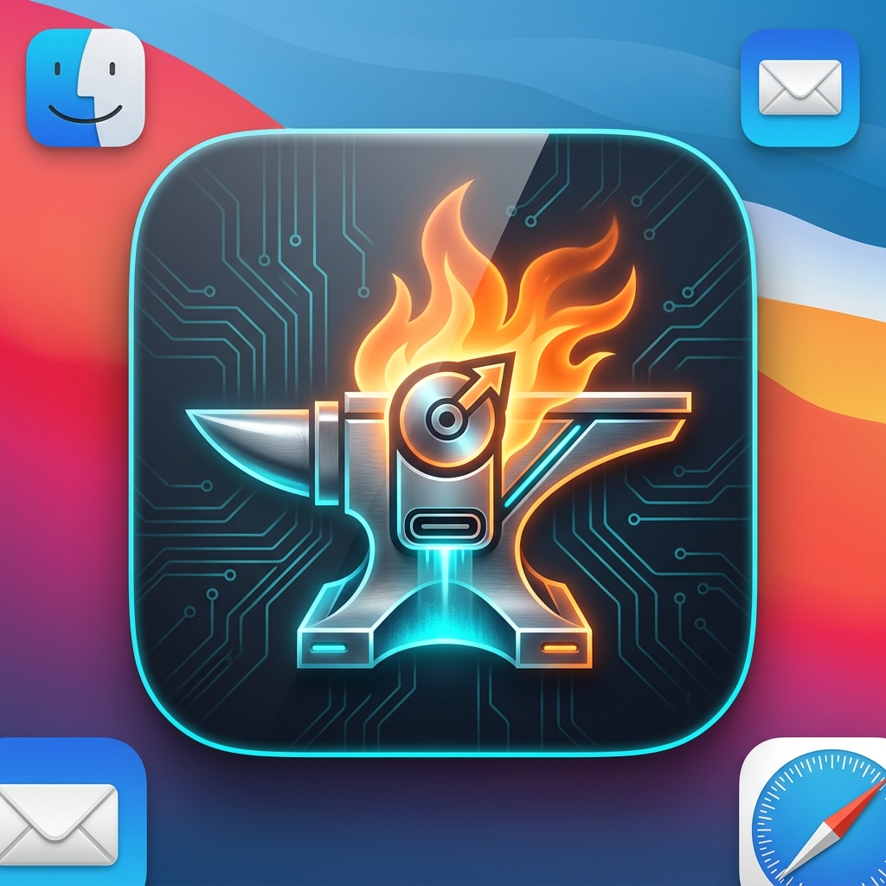
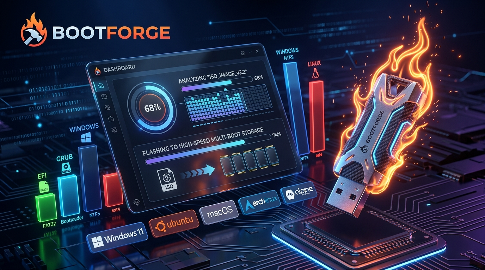

<p align="center">
  
</p>

<h1 align="center">⚡ Botdigit BootForge</h1>
<h3 align="center"><em>Universal Boot-Media Engineering Platform & Standalone Recovery OS</em></h3>

<p align="center">
  <a href="https://botdigit.com"></a>
  <a href="https://boot.botdigit.site/"></a>
  <a href="https://github.com/botdigit-official/BootForge"></a>
  <a href="https://github.com/botdigit-official/BootForge"></a>
  <a href="LICENSE"></a>
</p>

<p align="center">
  
</p>

> **BootForge = Rufus + Ventoy + Rescue OS + Disk Doctor + Boot Intelligence**  
> An industrial-grade, memory-safe cross-platform boot-media engineering platform and standalone recovery operating environment by [Botdigit](https://botdigit.com). Drop any disk image—BootForge deeply analyzes it, deduces firmware compatibility, safely crafts multi-boot storage media, tests it in automated virtual environments, and provides a full-featured live Recovery OS when systems fail.

---

### 🌐 Official Links & Downloads

- 🏢 **Official Publisher:** [https://botdigit.com](https://botdigit.com)
- 🌍 **Official Landing Page & Simulator:** [https://boot.botdigit.site/](https://boot.botdigit.site/)
- 🍏 **macOS Universal DMG:** [BootForge-macOS.dmg](https://boot.botdigit.site/assets/BootForge-macOS.dmg) (Apple Silicon & Intel)
- 🪟 **Windows 64-bit EXE:** [BootForge-Setup-x64.exe](https://github.com/botdigit-official/BootForge/releases)
- 🐧 **Linux AppImage & Deb:** [BootForge Linux Releases](https://github.com/botdigit-official/BootForge/releases)
- 📦 **Install CLI via Cargo:**
  ```bash
  cargo install bootforge-cli
  ```
- ⚡ **Run Local Web Engine:**
  ```bash
  cargo run -p bootforge-cli -- serve --port 41020
  ```

---

## 📑 Table of Contents

1. [Product Vision & Engineering Scope](#-product-vision--engineering-scope)
2. [Unified 4-Product Ecosystem](#-unified-4-product-ecosystem)
3. [Technology Stack & Architectural Strategy](#-technology-stack--architectural-strategy)
4. [Platform-Specific Storage Adapters & Device Capabilities](#-platform-specific-storage-adapters--device-capabilities)
5. [Firmware & Hardware Realities: Apple Silicon vs. PC vs. Intel Mac](#-firmware--hardware-realities-apple-silicon-vs-pc-vs-intel-mac)
6. [10-Layer Boot Intelligence Engine](#-10-layer-boot-intelligence-engine)
7. [Intelligent Storage Strategy & Boot Matrix](#-intelligent-storage-strategy--boot-matrix)
8. [OperationPlan, Safety Transaction Engine & Journaling](#-operationplan-safety-transaction-engine--journaling)
9. [BootForge Recovery OS & OS Doctor](#-bootforge-recovery-os--os-doctor)
10. [Automated QEMU Empirical Validation & Compatibility DB](#-automated-qemu-empirical-validation--compatibility-db)
11. [Repository Structure & Crate Hierarchy](#-repository-structure--crate-hierarchy)
12. [Development Roadmap & Verification Matrix](#-development-roadmap--verification-matrix)
13. [Current CLI & REST Reference](#-current-cli--rest-reference)
14. [License & Engineering Credits](#-license--engineering-credits)

---

## 🎯 Product Vision & Engineering Scope

Traditional bootable media utilities are either single-ISO flashers (Rufus / Etcher) or platform-locked scripts without safety or recovery layers. 

**BootForge** provides a complete end-to-end boot engineering workflow:

```
                BOOTFORGE
                    │
                    ▼
             Drop an ISO here
                    │
                    ▼
             Boot Intelligence
                    │
       ┌────────────┼─────────────┐
       │            │             │
   What OS?     Architecture?   Boot?
       │            │             │
       └────────────┼─────────────┘
                    ▼
            Strategy Selection
                    │
                    ▼
             Drive Intelligence
                    │
                    ▼
             Safety Transaction
                    │
                    ▼
              Build USB/SSD
                    │
                    ▼
                Verify
                    │
                    ▼
              QEMU Test
                    │
                    ▼
             ┌──────┴──────┐
             │             │
           PASS          REVIEW
             │
             ▼
        BOOTFORGE DRIVE
             │
      ┌──────┼────────┐
      │      │        │
   Windows Linux   Recovery
                   │
                   ▼
              OS DOCTOR
                   │
          ┌────────┼────────┐
          │        │        │
        Repair   Recover  Diagnose
```

---

## 🏛️ Unified 4-Product Ecosystem

BootForge is architected as **four products sharing a common Rust Core Engine**:

```
                         BOTDIGIT BOOTFORGE
                                │
             ┌──────────────────┼──────────────────┐
             │                  │                  │
        Desktop App        Android App       BootForge OS
             │                  │                  │
      ┌──────┴──────┐           │           ┌──────┴──────┐
      │             │           │           │             │
    macOS        Windows      Android     USB/SSD       Recovery
   (Intel/M)     (10/11)        (OTG)     (Multi-Boot)   (Live OS)
      │             │           │           │             │
      └──────┬──────┘           │           └──────┬──────┘
             │                  │                  │
             └──────────────────┼──────────────────┘
                                │
                         RUST CORE ENGINE
                                │
       ┌────────────┬───────────┼───────────┬────────────┐
       │            │           │           │            │
    Analyzer     Storage     Boot Engine  Safety     Network
       │            │           │           │            │
      ISO        GPT/MBR       UEFI       Guards      Downloads
      UDF        FAT/NTFS      GRUB       Verify      SHA256
      WIM/ESD    exFAT         EFI/Shim   Backup      Catalog
      IMG/RAW    SMART         Windows    Rollback    Updates
      VHD/VHDX   USB/NVMe      Doctor     Audit Log   Metadata
```

### 1. Desktop Application (Windows, macOS Intel & Apple Silicon, Linux)
* **Framework**: Tauri 2 + Rust + React / TypeScript (Tailwind CSS + Glassmorphism).
* **Communication**: Direct Rust FFI commands with zero network overhead.
* **Optional Daemon**: Embedded Axum 0.8 REST server for automation, CLI plugins, and remote scripting.

### 2. Android Mobile Companion (USB Host OTG)
* **Framework**: Kotlin + Jetpack Compose UI with Rust bridge via JNI / UniFFI.
* **Scope**: Hardware-dependent mobile emergency rescue creator operating over Android USB Host with userspace SCSI/BOT transport on supported OTG configurations.

### 3. BootForge Multi-Boot Drive
* **Model**: UEFI 2.11 FAT32 ESP + dynamic data partitions (exFAT / NTFS / ext4).
* **Workflow**: Drop ISOs, WIMs, and VHDs into the `/images` directory; the dynamic bootloader indexes payloads at boot time.

### 4. Standalone BootForge Recovery OS & OS Doctor
* **Model**: Dedicated live operating environment (Linux Kernel + BusyBox + standalone Rust userspace daemons) embedded on the USB drive.
* **Independence**: Fully self-contained; operates bare-metal when the host computer's OS or desktop utility is completely inaccessible.

---

## ⚙️ Technology Stack & Architectural Strategy

| Subsystem | Technology | Strategic Role |
|---|---|---|
| **Core Engine** | **Rust 2021 / 2024** | Memory-safe disk I/O, partition table manipulation, binary header parsing. |
| **Async Runtime** | **Tokio 1.x** | Multi-threaded async runtime for concurrent streaming, hash computation, background jobs. |
| **Desktop Shell** | **Tauri 2 (Rust + Webview)** | Cross-platform desktop shell with direct Rust FFI commands. |
| **Desktop UI** | **React + TypeScript + Tailwind** | Modular, capability-driven UI with real-time transfer telemetry. |
| **Android Shell** | **Kotlin + Jetpack Compose** | Native Android UI leveraging `android.hardware.usb.UsbManager` with UniFFI. |
| **Recovery OS Kernel** | **Linux LTS Kernel** | Universal hardware compatibility (NVMe, SATA, Wi-Fi, Ethernet, GPUs). |
| **Recovery Userspace** | **Standalone Rust Daemons** | Safe recovery agents for partition repair, file undelete, network tests, disk cloning. |
| **Virtual Testing** | **QEMU (UEFI / BIOS)** | Headless and interactive automated empirical boot validation. |
| **Local Database** | **SQLite (Rusqlite / SQLx)** | Local telemetry cache and offline Compatibility Database. |
| **CLI Framework** | **Clap 4.5 (Derive)** | Full headless automation and terminal scripting interface. |

---

## 🔌 Platform-Specific Storage Adapters & Device Capabilities

Low-level block I/O is abstracted through the `StorageDevice` trait, supported by platform-specific adapters:

```rust
pub trait StorageDevice: Send + Sync {
    fn identity(&self) -> DeviceIdentity;
    fn capabilities(&self) -> DeviceCapabilities;
    fn partitions(&self) -> Result<Vec<PartitionDetail>>;
    fn unmount_all(&self) -> Result<()>;
    fn lock(&self) -> Result<()>;
    fn unlock(&self) -> Result<()>;
    fn raw_read(&self, offset: u64, buf: &mut [u8]) -> Result<usize>;
    fn raw_write(&self, offset: u64, buf: &[u8]) -> Result<usize>;
    fn flush(&self) -> Result<()>;
    fn eject(&self) -> Result<()>;
}
```

```
                        StorageDevice Trait
                                │
        ┌───────────────────────┼───────────────────────┐
        │                       │                       │
 ┌──────────────┐        ┌──────────────┐        ┌──────────────┐
 │   Windows    │        │    macOS     │        │    Linux     │
 │ Win32 IOCTL  │        │ Disk Arbitr. │        │ udev / block │
 └──────┬───────┘        └──────┬───────┘        └──────┬───────┘
        │                       │                       │
        ▼                       ▼                       ▼
CreateFileW()           DASessionCreate()       /dev/disk/by-id/
DeviceIoControl()       DADiskUnmount()         libblkid / udisks2
FSCTL_LOCK_VOLUME       IOKit USB Speeds        Direct O_DIRECT
```

### Capability-Driven UI (`DeviceCapabilities`)
Instead of presenting universal action buttons, the UI dynamically reflects what each device safely supports:

```rust
pub struct DeviceCapabilities {
    pub can_raw_write: bool,
    pub can_partition: bool,
    pub can_unmount: bool,
    pub has_smart_telemetry: bool,
    pub supports_trim: bool,
    pub supports_hardware_eject: bool,
    pub is_usb_mass_storage: bool,
    pub is_nvme: bool,
    pub is_bootable: bool,
}
```

---

## 🍏 Firmware & Hardware Realities: Apple Silicon vs. PC vs. Intel Mac

BootForge enforces exact firmware distinctions to eliminate false universal boot claims:

| Platform | Firmware / Boot ROM | Boot Mechanism | BootForge Policy |
|---|---|---|---|
| **Standard PC (x86_64)** | UEFI 2.x / 2.11 + CSM BIOS | Direct NVRAM / El Torito / Shim | **Full Universal Multi-Boot** (GRUB2 / WIMBOOT / Direct) |
| **Intel Mac (x86_64)** | Apple EFI (Intel UEFI 2.x) | Option-Key Bootloader (`boot.efi`) | **Full Multi-Boot** (Apple EFI Chainloader + Windows + Linux) |
| **Apple Silicon (M1–M4)** | Apple Boot ROM $\rightarrow$ LLB/iBoot | LocalPolicy + RecoveryOS Auth | **Conditional Intelligence**: Prepares ARM64 media; explicitly informs user of RecoveryOS authorization requirements. |
| **ARM64 PCs (Snapdragon X)**| Qualcomm UEFI 2.x + Secure Boot | UEFI AArch64 Shim (`BOOTAA64.EFI`)| **Native ARM64 Multi-Boot** (ARM64 Windows / Linux PE) |

```
platform/
├── macos/
│   ├── intel/           # Apple EFI 64-bit chainloading
│   └── apple_silicon/   # Asahi / ARM64 policy & LocalPolicy advisory
├── windows/             # Win32 DeviceIoControl & Storage IOCTLs
├── linux/               # udev, libblkid, direct block I/O
└── android/             # USB Host OTG userspace SCSI/BOT transport
```

---

## 🔬 10-Layer Boot Intelligence Engine

BootForge combines **9 layers of static deduction** with **Layer 10 empirical validation**:

```
┌────────────────────────────────────────────────────────────────────────┐
│                      10-LAYER BOOT INTELLIGENCE                        │
└────────────────────────────────────────────────────────────────────────┘
  Layer 1:  File Validation      → Magic bytes, WIM header, VHD footer, hashes
  Layer 2:  Filesystem Analysis  → ISO 9660 PVD/SVD, UDF descriptors, FAT/exFAT
  Layer 3:  Partition Maps       → MBR (0x55AA), GPT headers, protective MBR
  Layer 4:  Bootloader Artifacts → El Torito catalog, EFI/BOOT/, GRUB, BCD, syslinux
  Layer 5:  Binary Architecture  → PE Machine header / ELF machine header analysis
  Layer 6:  Security Signatures  → Microsoft UEFI CA, Shim x64, MokManager, MOK
  Layer 7:  OS Identification    → Version strings, kernel patterns, package manifests
  Layer 8:  Hardware Feasibility → BIOS, UEFI, x86_64, ARM64, Apple Silicon, TPM 2.0
  Layer 9:  Strategy Selector    → RAW_WRITE, GRUB_LOOPBACK, EFI_CHAIN, WIMBOOT, SWM
  Layer 10: Empirical Validation → Automated QEMU boot test (UEFI + BIOS)
```

### Compatibility Score vs. Boot Confidence
BootForge distinguishes heuristic prediction from verified test evidence:
* **Compatibility Score (0–100%)**: Static structural evaluation based on file headers, EFI binaries, and signatures.
* **Boot Confidence**:
  - **High**: Static evaluation passed **AND** Layer 10 QEMU boot test passed.
  - **Medium**: Static evaluation passed, but empirical test has not yet run.
  - **Low**: Missing bootloader artifacts or firmware quirks detected.

---

## 💽 Intelligent Storage Strategy & Boot Matrix

### UEFI 2.11 Compliance
Per UEFI 2.11 removable media specifications, the **EFI System Partition (ESP) is strictly FAT32** with architecture-specific paths:
* `EFI/BOOT/BOOTX64.EFI` (x86_64)
* `EFI/BOOT/BOOTAA64.EFI` (ARM64 / AArch64)
* `EFI/BOOT/BOOTIA32.EFI` (IA-32)

### Dynamic Storage Strategy Engine
The data partition filesystem is selected dynamically based on payload requirements:

```
                          Image & Goal Input
                                  │
                                  ▼
                 ┌─────────────────────────────────┐
                 │  Storage Strategy Engine        │
                 └────────────────┬────────────────┘
                                  │
         ┌────────────────────────┼────────────────────────┐
         ▼                        ▼                        ▼
 ┌───────────────┐        ┌───────────────┐        ┌───────────────┐
 │ Universal GPT │        │ Windows-Heavy │        │ Direct Raw    │
 │ ESP: FAT32    │        │ ESP: FAT32    │        │ Sector Copy   │
 │ DATA: exFAT   │        │ DATA: NTFS    │        │ Hybrid ISO    │
 └───────────────┘        └───────────────┘        └───────────────┘
```

---

## 🛡️ OperationPlan, Safety Transaction Engine & Journaling

All disk modifications execute through a strictly staged **OperationPlan**:

```
[ Analyzer ] ──▶ [ Planner ] ──▶ [ Safety Validator ] ──▶ [ User Approval ]
                                                                 │
                                                                 ▼
[ Post-Verify ] ◀── [ Commit ] ◀── [ Atomic Executor ] ◀─────────┘
```

### Resumable Journal (`bootforge-journal`)
Every operation logs state to `/.bootforge/journal/` on the storage media:
* **Preconditions**: Device identity match, unmount confirmation, capacity check.
* **Metadata Backup**: Snapshots of existing GPT, MBR, and partition tables.
* **State Machine**: `RUNNING`, `PAUSED`, `CANCELLED`, `INTERRUPTED`, `COMMITTED`, `ROLLED_BACK`.
* **Resumable Transfers**: Interrupted multi-gigabyte ISO transfers resume from the verified byte offset rather than restarting.

---

## 🩺 BootForge Recovery OS & OS Doctor

**BootForge Recovery OS** is a standalone, bare-metal operating environment (Linux LTS Kernel + BusyBox + native Rust daemons) embedded on the boot drive.

```
┌────────────────────────────────────────────────────────┐
│               BOOTFORGE RECOVERY OS DAEMON             │
├────────────────────────────────────────────────────────┤
│  1. 🩺 OS Doctor (Scan, Diagnose, Plan, Backup, Fix)   │
│  2. 🪟 Windows Boot Manager & BCD Reconstruction       │
│  3. 🐧 Linux GRUB2 & EFI Variable Repair               │
│  4. ✂️ Partition Table Repair (GPT / MBR)              │
│  5. 💾 Bare-Metal Disk Cloning (Disk ↔ Disk / Image)   │
│  6. 🔍 File Recovery & Undelete (FAT/NTFS/exFAT/ext4)  │
│  7. 🔐 Authorized System & Account Recovery            │
│  8. 🧹 Secure Disk Sanitizer & Drive Eraser (NIST SP)  │
│  9. 🧠 Standalone Memory Diagnostics (MemTest86+)      │
│ 10. 🌐 Emergency Network Diagnostics & Remote Shell    │
└────────────────────────────────────────────────────────┘
```

### OS Doctor Diagnostic Workflow
Never applies unprompted destructive changes. Follows a **6-stage pipeline**:
$$\text{SCAN} \longrightarrow \text{DIAGNOSE} \longrightarrow \text{EXPLAIN} \longrightarrow \text{BACKUP} \longrightarrow \text{REPAIR} \longrightarrow \text{VERIFY}$$

---

## 🧪 Automated QEMU Empirical Validation & Compatibility DB

BootForge integrates headless QEMU testing to capture structured telemetry:

```json
{
  "image_fingerprint": "a3f8c1...9b2",
  "firmware": "UEFI_2.11",
  "architecture": "x86_64",
  "secure_boot": true,
  "boot_success": true,
  "boot_time_ms": 3840,
  "detected_loader": "GRUB_2.12",
  "error": null
}
```

This telemetry powers the offline/cloud **BootForge Compatibility Database**, providing empirical confidence ratings and quirk workarounds for thousands of distributions.

---

## 📁 Repository Structure & Crate Hierarchy

```
bootforge/
├── Cargo.toml                          # Cargo Workspace Manifest
├── crates/
│   ├── bootforge-core/                 # Core types, DeviceIdentity, error types
│   ├── bootforge-analyzers/            # 10-layer ISO/UDF/WIM/ELF/PE analyzer
│   ├── bootforge-engines/              # GRUB2, EFI layout, Windows BCD engines
│   ├── bootforge-safety/               # Transaction engine, system guards, rollback
│   ├── bootforge-managers/             # Device scanners, S.M.A.R.T., streaming
│   ├── bootforge-recovery/             # OS Doctor, repair algorithms, cloning
│   ├── bootforge-catalog/              # Curated downloads, compatibility database
│   ├── bootforge-qemu/                 # Automated VM test harness
│   └── bootforge-cli/                  # Terminal interface & optional REST daemon
├── apps/
│   ├── desktop/                        # Tauri 2 + React + TypeScript App
│   ├── android/                        # Kotlin + Jetpack Compose Mobile App
│   └── recovery-os/                    # BootForge Live Recovery OS builder
├── boot/
│   ├── efi/                            # Architecture-aware EFI binaries (x64/aa64)
│   └── themes/                         # Glassmorphism boot themes
├── tests/                              # Integration & automated QEMU test suites
└── docs/                               # Architectural blueprints & specs
```

---

## 🗺️ Development Roadmap & Verification Matrix

### Verification Matrix
| Phase / Component | Automated Test Suite | Physical Hardware Matrix | Status |
|---|---|---|---|
| **Phase 1: Rust Core & CLI** | `cargo test --workspace` (24 passing) | macOS Darwin, Win32, Linux block | **Verified** |
| **Phase 2: Tauri Desktop Studio** | End-to-end Tauri test harness | Windows 11, macOS M-Series, Ubuntu | **In Progress** |
| **Phase 3: BootForge Media** | Partition layout test harness | SanDisk, Samsung NVMe, Kingston | Planned |
| **Phase 4: Intelligence & QEMU** | Headless QEMU test harness | Intel PC, AMD PC, Apple Silicon | Planned |
| **Phase 5: Recovery OS** | Live boot test harness | Bare-metal recovery test matrix | Planned |
| **Phase 6: Android Companion** | Android instrumentation tests | Samsung, Pixel USB-C OTG matrix | Planned |
| **Phase 7: Native Rust Microkernel** | no_std kernel test suite | QEMU x86_64 / AArch64 bare-metal | Research |

---

## 💻 Current CLI & REST Reference

### CLI Commands
```bash
# Scan and list all storage devices with safety flags and bus speeds
bootforge devices

# Deep inspect partition tables, S.M.A.R.T. health, and installed ISOs
bootforge analyze-device disk4

# Run 10-layer deep inspection on an ISO image
bootforge analyze /path/to/ubuntu-24.04-desktop-amd64.iso

# Launch the desktop web interface / REST API daemon
bootforge ui --port 4242
```

---

## 📜 License & Engineering Credits

Botdigit BootForge is open-source software licensed under the **[MIT License](LICENSE)**.  
Engineered with ⚡ by the **Botdigit Engineering Team**.
